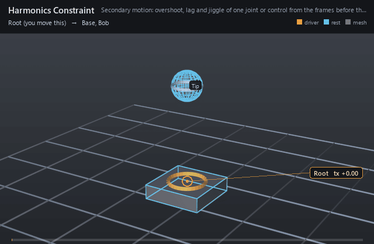
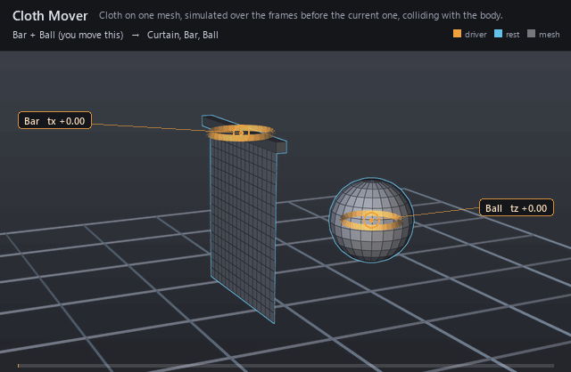
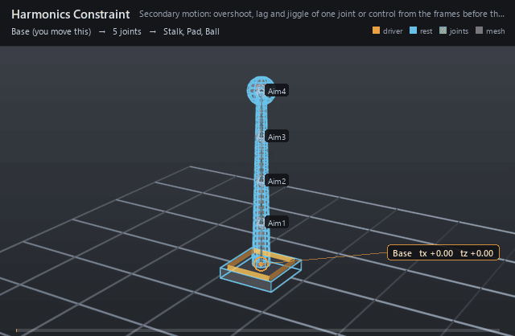

Two operators answer motion rather than pose:
[Harmonics Constraint](../nodes/harmonics_constraint.md) rings a joint or
control with the way it moved, and [Cloth Mover](../nodes/cloth_mover.md)
simulates a mesh hanging from and colliding with the character. Both are
*windowed* operations: the result at a frame is a pure function of their
inputs over a fixed number of frames before it and the frame itself. Nothing
is carried from one evaluation to the next, so a frame looks the same whether
it was reached by playing forward, scrubbing backward, jumping, a background
cache, or a `.rigexec` reader.





Both are rendered live from the node pages' examples,
`docs/examples/harmonics_constraint.usda` and `docs/examples/cloth_mover.usda`,
at the stage's frame rate; the rest pose is drawn in blue.

## The window

At every frame it runs, a windowed operation captures a *packet*: the inputs
its solve reads, and nothing computed from earlier frames. For the harmonics
constraint that is the target's incoming position in its measuring space; for
the cloth, the points entering the mover, every collider's points and the
parameters. The solve then reads the packets of the earlier frames, oldest
first, and the current one:

- the harmonics constraint adds, for each earlier frame, that frame's
  acceleration rung as a damped sine (the method of BlurHarmonics; see
  [references](../references.md)). Its window is
  `rigExec:waves * rigExec:waveLength / rigExec:frequency` frames, 25 by
  default.
- the cloth starts on its incoming points at the window's first frame,
  moving with them, and steps to the current one: `rigExec:substeps` steps
  per frame of extended position-based dynamics with coloured Gauss-Seidel
  constraints, tethers to the pins, and collision against the colliders'
  triangles swept between frames. Its window is `rigExec:windowFrames`
  frames, 16 by default, and starts earlier when a collider cuts through the
  incoming cloth (below).

A solve forgets everything older than its window, so a cloth's motion should
settle within it: `inputs:damping` (2 by default, which takes about 86% of a
swing's speed every second) sets how long a swing lasts. With much less
damping a swing set off more than a window ago is cut off in one frame when
it leaves the window, and the cloth flutters and pops.

## Where a cloth window starts

A cloth window normally starts `rigExec:windowFrames` before the current
frame, on the cloth's incoming points. When a collider cuts through those
points there, the solve would start with cloth inside the collider, and the
contact test, which pushes a point out only when it is within
`inputs:collisionDepth` of a surface, would let the deeper points out on
whichever side the collider reaches first: a ball pushed into a curtain
would drop the curtain behind it the moment the window's first frame passes
the ball's centre. The window therefore starts at the latest earlier frame
with no cloth edge crossing a collider triangle for a whole window on either
side of it (checking only as far as the current frame). This gives contact
a consistent settling interval before it begins, instead of replaying a
different startup transient into contact at each frame, and lets the motion
after contact settle. The curtain example uses `inputs:damping = 8` so the
bar's earlier swing loses over 99% of its speed within its 16-frame window.
It reaches back at most `rigExec:maxWindowFrames` frames (64 by default),
which is also the history the evaluator keeps for the cloth; at most
`rigExec:windowFrames` turns it off. Every evaluator makes the same choice
from the same packets.

## Earlier frames are generations of the same graph

The packets of the earlier frames come from *history ticks*: runs of the same
compiled operation graph at those times, masked to the windowed operations and
every operation they depend on. A history tick does not publish anything, and
operations outside the mask keep what they owe the next full run. There is no
second evaluator and no separate pre- or post-pass: history is produced by the
one loop, by the operations that produce the current frame.

The evaluator keeps a memo of captured packets per frame, keyed by the
program, the stage's edit serial and the upstream inputs. Playing forward
costs no history tick per frame, since each frame's own capture becomes the
next frame's history; a jump runs the ticks the memo lacks. An edit that
reaches the history clears the memo. The ring of earlier packets is placed at
the boundary before a generation, like any sampled input, and a changed ring
re-runs the windowed operation.

Inner windows chain: a windowed operation that reads another one's result
solves at the history ticks too, with its own ring, and the history reaches
back as far as the chain needs.

## Rings as rotation

The harmonics constraint rings a translation. To ring a chain's rotation,
ring targets and aim the joints at them:
[example 19](../../examples/19_HarmonicsChain.usda) aims each segment of a
stalk at a target control one segment higher and rings each target, larger
and slower up the stalk, so the stalk bends behind a move and whips past the
stop with its segment lengths unchanged. The stack runs bottom first: the
harmonics constraints, so the aims read the rung targets; whatever carries
the chain's base joint; then the aims from the base up, so each segment aims
from where the one below it left it.



## Drags

An interactive drag sets the current frame only. The earlier frames are the
authored animation, so a dragged control rings or swings the cloth exactly as
it would if the drag had been keyed at that frame alone. Time does not move
during a drag, so the drag reads as a sudden move at that frame: a harmonics
target is held back against the drag, further the further it goes, and its
ring plays only when the frame changes. A cloth's pinned points follow the
drag while the rest of it trails behind, so a dragged bar slants its curtain
back against the drag. Releasing the drag returns to the authored result bit
for bit.

## Background caches

A frame-cache job carries the rings it was sampled with: they are part of the
job's inputs, folded into its control digest, so two frames with the same
current inputs but different motion before them never share a cache entry. A
job's frozen program solves the same window as the live one and publishes the
same bits.

## .rigexec playback

A `.rigexec` file records the windowed operations; a reader keeps a window of
its own frames. A host that plays frames in order pushes each one after it
runs; a host that jumps replays the frames before the target first:

```cpp
// Playing: run the frame, then keep its packets as history.
sampler.Apply(t, reader.get(), &error);
reader->Execute(&error);
reader->PushHistory();

// Jumping to t: rebuild the history from the frames before it.
reader->ClearHistory();
for (size_t k = reader->GetHistoryDepth(); k >= 1; --k) {
    sampler.Apply(t - double(k), reader.get(), &error);
    reader->ExecuteHistory(&error);   // runs and pushes one earlier frame
}
sampler.Apply(t, reader.get(), &error);
reader->Execute(&error);
```

Fed this way, the reader publishes what the native evaluator does, bit for
bit. A reader's first frames have less history than the window;
`rigExec:ignoreFirstFrame` keeps the harmonics constraint from ringing at the
jolt of starting from rest. The runtime plays the cloth itself
(`RigExecClothPlaybackKernel`), so a file plays in a host that loads no mover
library. `usdview`'s binary playback pushes on consecutive frames and rebuilds
the history on a jump. `rigExecPose --verify-binary` replays history for a
rig with windowed operations.

The standalone scene program (the rigpack path) refuses windowed operations.

## Cloth materials and bindings

`rigExec:constraints` on the cloth mover targets ordered
`RigExecClothConstraintSet` prims. Their `rigExec:kind` selects `stretch`,
`bend`, `damping`, `pin`, `tether`, `attachment`, `collision` or
`selfCollision`. These are data consumed by the existing cloth operation,
not extra operations. Material profiles replace the legacy scalar in their
selected region; the last matching profile wins. Pins and attachments add
constraints. The legacy pin weights still apply: clear them on vertices
that should have a soft pin instead of an immovable pin.

`rigExec:restShape` targets a Mesh or a `point3f[]` property with the same
vertex count and ordering as the cloth. Its local-space points determine
stretch, bend and measured attachment rest distances. Without it, the
cloth's default points are the rest shape. `rigExec:uvSet` targets an exact
`texCoord2f[]` or `float2[]` primvar. Indexed vertex, varying and face-varying
UVs are supported. U defines warp; the orthogonal in-plane direction defines
weft. Incident triangle tangents are averaged at shared vertices. Split
vertices where a material direction must be discontinuous across a UV seam.

Every constraint has warp, weft and normal multipliers, minimum and maximum
strength, and an optional `float2[] rigExec:forceCurve`. Keys are
`(force, blend)` with increasing nonnegative force and blend in `[0,1]`.
The piecewise linear curve clamps at its endpoints. Strength is
`min + (max - min) * blend`, multiplied by the painted mask and directional
response. Without a curve, blend is one. Descending blends soften under
load; ascending blends stiffen. The load estimate uses the XPBD multiplier
and predicted correction divided by substep time squared, in normalized
cloth mass times local distance per second squared. It is a solver load
estimate, not a calibrated physical measurement.

`rigExec:mode = "soft"` uses compliance divided by strength. `"hard"`
uses zero compliance at any positive strength; zero strength disables that
response. Hard constraints converge over the requested iterations, and
contradictory hard constraints cannot all be satisfied. Damping treats
strength as a rate per second along each material axis; hard damping removes
velocity along enabled axes. Bend retains the mesh's opposite-vertex
distance constraint model, with directional stiffness.

`rigExec:sourceBinding` and `rigExec:targetBinding` target
`RigExecClothBinding` prims. Absent source bindings select all vertices for
material/contact/pin profiles. Attachments require equally sized source and
target sample lists. Binding modes are:

- `vertex`: `rigExec:indices` contains vertex indices.
- `barycentric`: indices name triangles in orientation-correct fan order;
  `rigExec:coordinates` contains nonnegative triples summing to one.
- `uv`: coordinates contain `(u,v,0)`. Optional triangle indices disambiguate
  overlapping UV islands. Samples outside the UVs, ambiguous overlaps and
  invalid triangle indices are rejected.

For material and contact regions, samples select vertices with positive
barycentric support; paint maps control response strength. Pin and attachment constraints
act on the actual interpolated sample. An explicit-target tether supports
the same bindings and only enforces a maximum distance. Automatic tethers
use the legacy nearest pinned vertex.

The eight map relationships are `rigExec:maskMap`, `minStrengthMap`,
`maxStrengthMap`, `warpMap`, `weftMap`, `normalMap`, `thicknessMap` and
`frictionMap` (all names have the `rigExec:` prefix). Each targets an exact
`float[]` property or a `RigExecClothMap` prim. Values multiply the associated
scalar; one value broadcasts, otherwise provide one per cloth vertex.
`RigExecClothMap.rigExec:values` links an existing painted array, including a
dense static weight array. `rigExec:binding` supplies one sample per destination
cloth vertex; `rigExec:sourceMesh` optionally supplies the mesh to sample.
This transfers painted fields using vertex, barycentric or UV bindings.
These are paintable data relationships; they do not add a new paint brush UI
or sample image textures. Profiles, maps, UVs, topology and rest shape are
captured default values; edits invalidate the compiled epoch, while animated
entering geometry and collider motion remain per-frame inputs.

Attachments never add collision exclusions. Author a `selfCollision` profile
for contact between regions of the simulated mesh, including disconnected
cloth panels, and an `attachment` profile for links between them. Both sides
receive mass-weighted corrections. Self-contact tests nonadjacent
vertex/triangle and edge/edge pairs; topological one-ring neighbors are
excluded regardless of attachments. `inputs:restLength = -1` measures an
internal link in the rest shape; zero joins its samples. Choose compatible
rest distances and contact thickness for overlapping hard constraints.

An external `rigExec:targetMesh` is captured at the mover's collider read
phase and also enters its collider list. External attachments require an
explicit nonnegative rest length. External meshes are kinematic inputs to
this mover; they do not receive reciprocal corrections. For mutually coupled
cloth panels, place the panels in the same simulated mesh. Collision profiles
default to two-sided contact and can select an external mesh and target
region. Substeps and collision depth bound contact detection; this is not
continuous collision detection for arbitrarily fast motion.

The layered [cloth materials example](../examples/cloth_materials.usda) adds
directional stretch, bend and damping, a painted map, a hem attachment and
independent self-contact to the curtain animation.

Python authoring uses the same relationships:

```python
cloth.set_rest_shape("/Asset/Rest")
cloth.set_uv_set("/Asset/Cloth.primvars:st")
stretch = cloth.add_constraint("Stretch", "stretch", "soft")
stretch.set_strength(0.2, 1.0)
stretch.set_force_curve([(0, 1), (100, 0)])
stretch.set_material_directions(warp=4, weft=1, normal=1)
paint = cloth.add_map("StretchPaint")
paint.set_values_source("/Asset/Cloth.primvars:stretch")
stretch.set_map("mask", paint)
contact = cloth.add_constraint("SelfContact", "selfCollision", "hard")
contact.set_contact(thickness=0.1, friction=0.3)
```

Live, frozen and binary playback use the same CPU profile solver. A
`.rigexec` file from format 26 on carries the cloth epoch `RCL3`, which holds
`rigExec:maxWindowFrames`, the profiles and the resolved bindings. A format-25
file carries `RCL1` and plays as it was exported: no reach-back window, no
profiles, and its inputs in the format-25 order. A reader older than format 26
refuses a format-26 file at the version check; rebake for it.

## The cloth on the GPU

The live evaluator solves a cloth without relationship-linked profiles on the GPU when a host registered the
device (`usdview` and the Python module do), the cloth has at least
`RIGEXEC_GPU_CLOTH_MIN_POINTS` points (2048 by default; below that the CPU is
faster), its mover is the last on its mesh, and nothing else in the rig reads
the cloth's points. The operation body still captures the packet on the CPU;
the solve waits for the publication boundary, where it runs on the device
thread through the existing executor queue, and the mesh's normals and extent
are computed again on the result. The window's start is chosen on the CPU
before the dispatch. `RIGEXEC_GPU_CLOTH=0` keeps every cloth on the CPU.

The GPU runs the same passes in the same order as the CPU kernel, one dispatch
per pass over the whole cloth, so it agrees with the CPU to float rounding,
not bit for bit: on the test scenes the mean difference is under a hundredth
of the cloth's edge length. A scene that folds at a knife edge can fold the
other way on the GPU, as it would on the CPU for a change of a ten-thousandth
in its input. Background caches, history ticks and `.rigexec` readers always
solve on the CPU, and the parity tests run the CPU.

## Cost

Each evaluation of a cloth solves `rigExec:windowFrames * rigExec:substeps`
steps, 160 by default, and up to `rigExec:maxWindowFrames * rigExec:substeps`
while a window reaches back past a contact; a jump runs a history tick for
each of the `rigExec:maxWindowFrames` frames the evaluator keeps. Measured on
one machine (an RTX 4090 and one core of
an i9-13900KF) for a pinned curtain swept by a sphere of as many triangles:

| Cloth points | CPU | GPU |
|---|---|---|
| 576 | 20 ms | 16 ms |
| 2304 | 148 ms | 37 ms |
| 9216 | 1.38 s | 0.23 s |

The docs example's 289-point curtain takes about 14 ms a frame on the CPU,
and about 50 ms while the ball is in it and the window reaches back.
Collision dominates: a particle tests the collider triangles listed in its
own grid cell, which holds every triangle whose box, swept over the frame and
padded by `max(thickness, collisionDepth)`, contains the cell. Fewer
substeps, a shorter window or a smaller collision depth cost less.

## Limits

- The cloth's points and its colliders' points are read in their own local
  spaces, which must be the same space, as meshes skinned under one rig
  usually are.
- Legacy colliders are one-sided along their outward normals. Relationship
  profiles enable two-sided contact and self-contact on the CPU.
- A collider that stays through the incoming cloth for longer than
  `rigExec:maxWindowFrames` starts the window inside it, and the cloth can
  come out on the wrong side.
- A cloth is chaotic where it folds at a knife edge: which way a fold falls
  can change from one frame's window to the next, and between the CPU and
  the GPU.
- The cloth's topology, rest points and pins, and its colliders' topology,
  are fixed for a compile; editing them recompiles.
- A frame the cloth is disabled at holds no packet, so the history after it
  starts there.
- Mover plugins built for API 5 must be rebuilt for API 6, which added the
  windowed hooks ([external movers](external-movers.md#windowed-movers)).
