# Tutorial: a rolling ball rig

Move a control across the floor and let the rig turn the ball for you. In this
3-minute lesson, you'll build that behavior by hand in **usdview and Noodles**:
one control, a Matrix Mover, and a Float Math Mover. Every authoring step uses
the UI, with no Python or script entry.

## Watch the lesson

<video controls preload="metadata" width="100%" poster="../gifs/concepts/rolling-ball/step-20.jpg" src="../gifs/concepts/rolling-ball/tutorial.mp4" aria-label="Build a rolling ball rig in usdview">
Your browser does not support embedded video. Use the MP4 link below.
</video>

[Watch or download the full movie (3:13, MP4)](../gifs/concepts/rolling-ball/tutorial.mp4).
The viewport Move-tool demonstration starts at **2:52**; the continuous gizmo
drag starts at **2:58** and is shown at half speed so you can see the seams turn.

The 21 steps below match the movie's chapters. Each screenshot is a frame from
that movie; its caption gives the capture time. Open an image for full-size
node labels and connections.

## Get the starting files

Use a working usdRig installation with its usdview authoring tools; see
[Getting started](../guide/getting-started.md). The lesson files are in
`docs/examples/` in the checkout:

| File | What it contains |
|---|---|
| [RollingBallLesson.usda](../examples/RollingBallLesson.usda) | An empty root layer for your work. Copy it before starting. |
| [BallAsset-unrigged.usda](../examples/BallAsset-unrigged.usda) | The ball, floor, materials and camera, with no rig or rig variants. |
| [textures/basketball.png](../examples/textures/basketball.png) | The ball texture. Keep it in a `textures` folder beside the asset. |

Open your copy of **RollingBallLesson.usda** in usdview. Keep it beside the
unrigged asset so the relative sublayer path resolves. The movie's working
copy is named `RollingBallLesson-v3.usda`; the name does not affect the rig.
The empty viewport is expected: you'll bring the ball in through the
composition tools next.

## 1. Choose the root layer — 0:00

Open **Window → Layer Editor**. Under **Edit Target**, choose **Root Layer**.
Do this first, so the composition arc and every rig edit go into the file
you'll save.

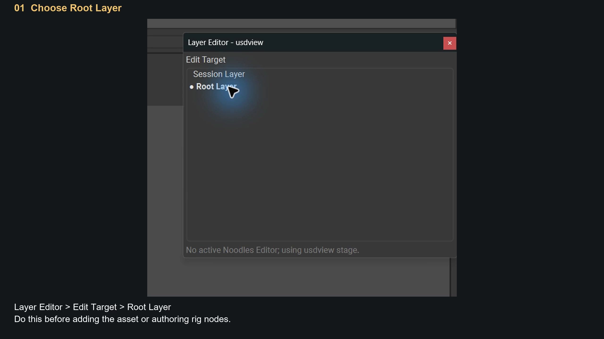

*Movie frame: 0:06.*

## 2. Add the ball as a sublayer — 0:07

Right-click the **stage root** in usdview's prim tree. Choose
**Add Composition Arc → Sublayer**.

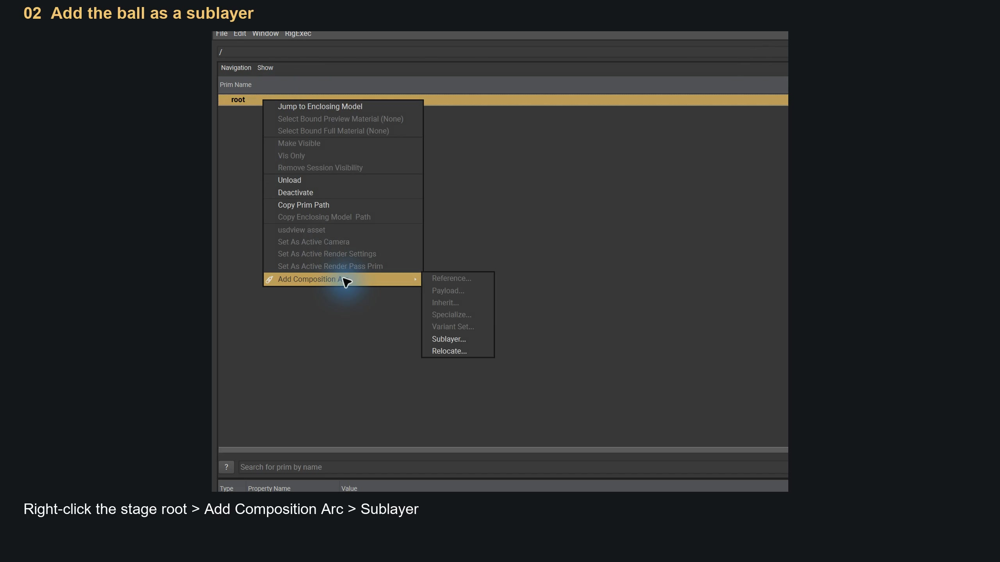

*Movie frame: 0:13.*

## 3. Author the composition arc — 0:15

Choose **BallAsset-unrigged.usda**. Leave **Offset** at `0` and **Scale** at
`1`, then click **Author**. This brings the geometry into your lesson layer.

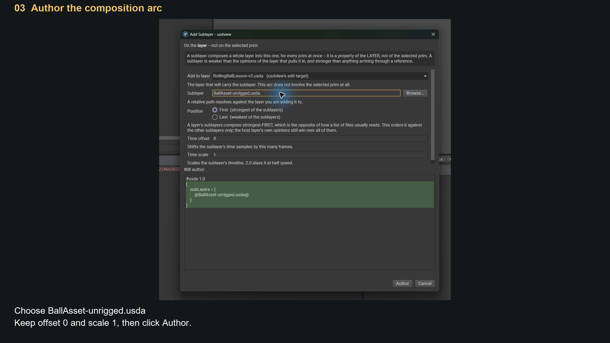

*Movie frame: 0:20.*

## 4. Check the unrigged asset — 0:22

Expand **BallAsset**. You should see **Looks**, **Geom**, and **MainCam**;
there is no rig yet. Choose **Camera → Select Camera → MainCam** to frame
the ball and floor as they appear in the movie.

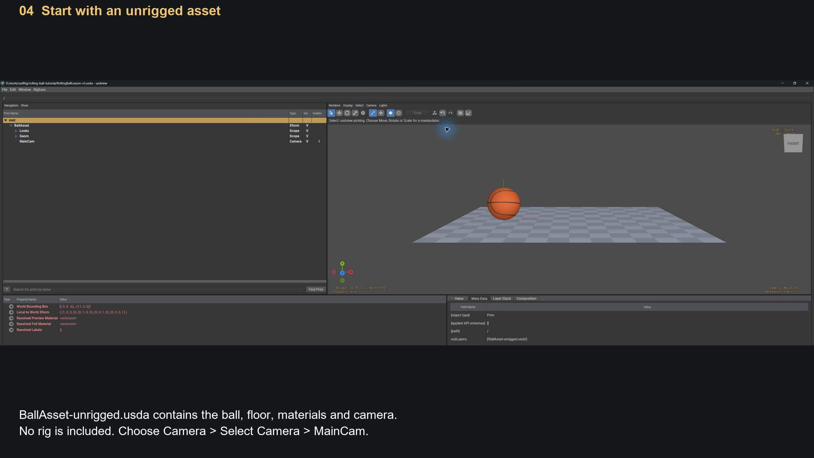

*Movie frame: 0:31.*

## 5. Open Noodles and create a rig root — 0:32

Select **BallAsset**, then **hit N to open Noodles**. Close the Layer Editor
if it is covering the graph. Click inside the Noodles canvas to give it
focus, then press **Tab** to open the node creation screen. Search for
**RigExecRoot** and press **Enter**.

You'll get **RigExecRoot1** under BallAsset. Keep usdview and Noodles visible
side by side. For every Tab action below, click Noodles first so it receives
the shortcut.

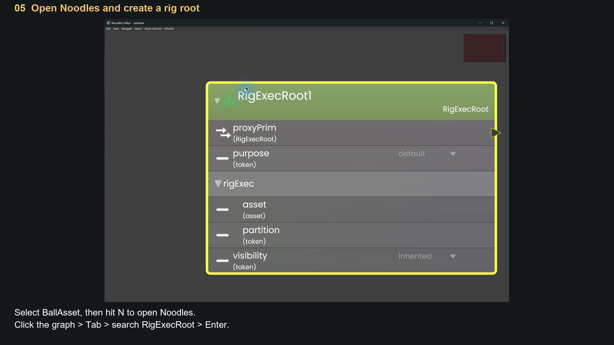

*Movie frame: 0:43.*

## 6. Create the ball control — 0:43

Select **RigExecRoot1 in the prim tree**, then focus Noodles and use
**Tab → RigExecControl**. The new **RigExecControl1** belongs under the rig
root. This is the control you'll move to roll the ball.

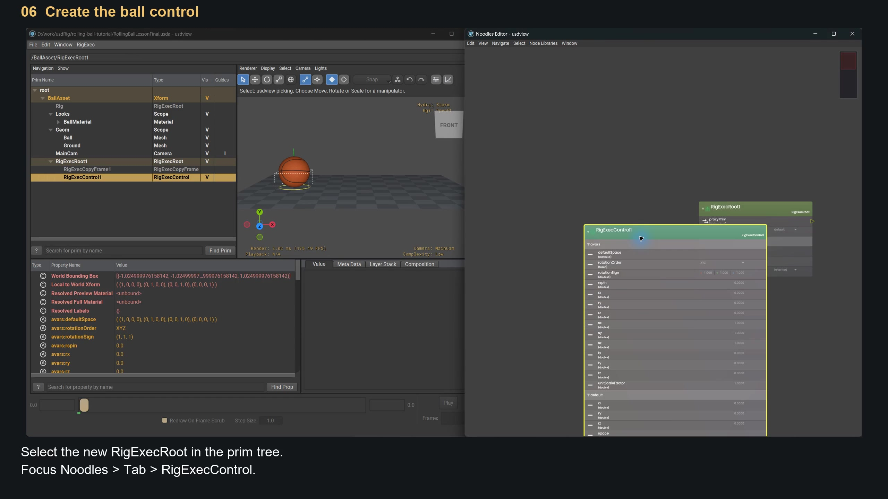

*Movie frame: 0:50.*

## 7. Put the rest pivot at the ball's center — 0:52

Expand the control's **rest** group. Set **rest:ty** to `1` and press
**Enter**. The ball has radius one and rests on a Y-up floor, so its center
is one unit above the ground. This makes it turn around its center.

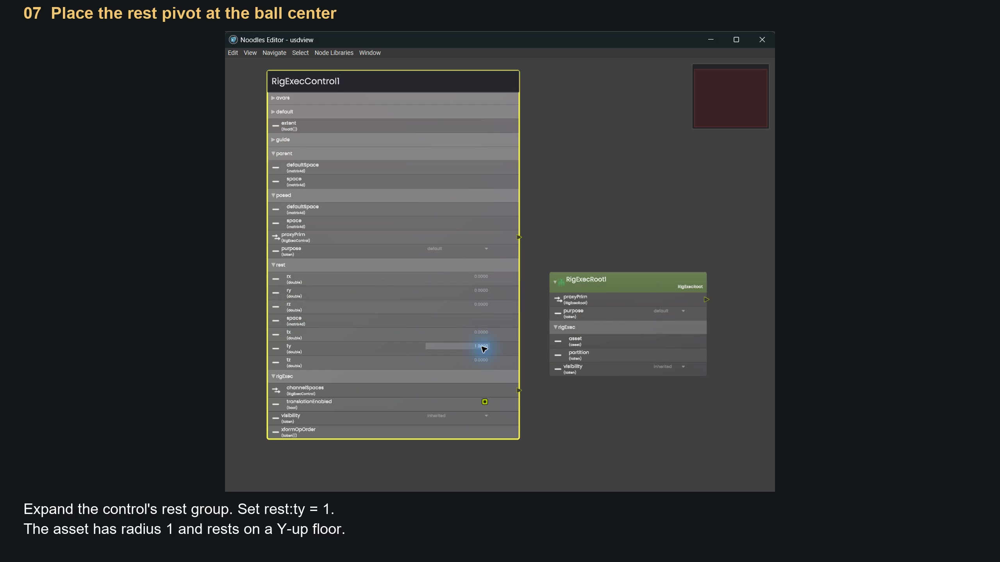

*Movie frame: 1:00.*

## 8. Create a Matrix Mover — 1:02

Select **RigExecRoot1** in the prim tree again. Focus Noodles and choose
**Tab → RigExecMatrixMover**.

This is the operation that moves the ball geometry and is driven by our
control.

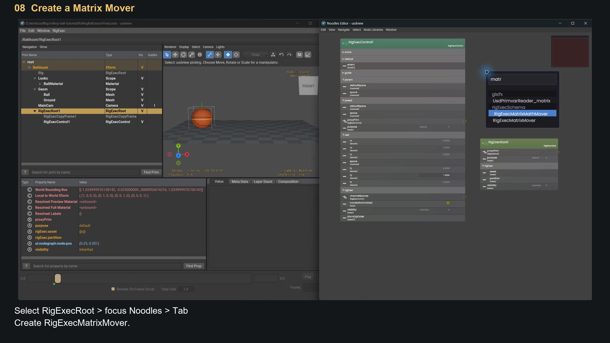

*Movie frame: 1:09.*

## 9. Apply the mover API — 1:11

Select the **Matrix Mover node**, then choose **Tab → RigExecMoverAPI**.
This is required for all movers. It exposes the common mover properties,
including **rigExec:moves**.

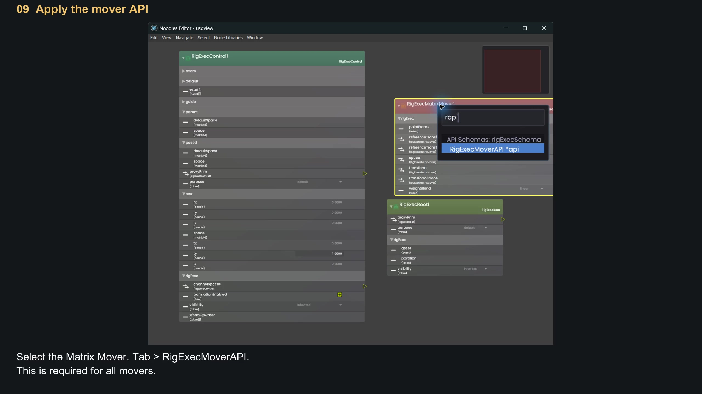

*Movie frame: 1:16.*

## 10. Connect the transform — 1:18

Arrange the Matrix Mover on the left and the control on the right so you
can see both ends of the connection. You can collapse the control for this
step. Drag the Matrix Mover's **rigExec:transform** socket onto the
**control's title bar**. The red wire confirms the relationship.

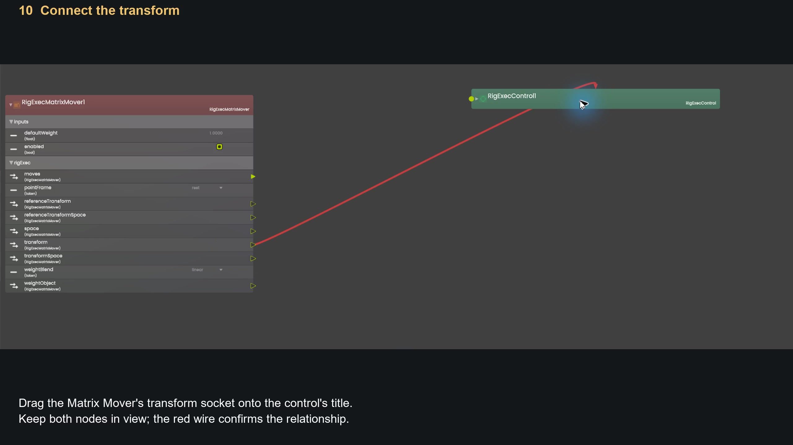

*Movie frame: 1:25.*

## 11. Bring the ball mesh into Noodles — 1:27

Select **BallAsset → Geom → Ball** in the prim tree. Click empty space in
Noodles and press **A** to add that existing prim to the graph.

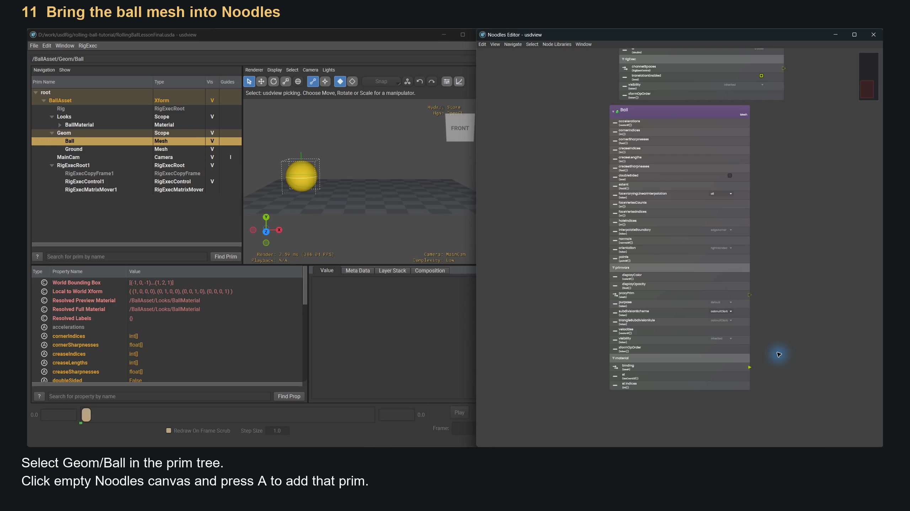

*Movie frame: 1:34.*

## 12. Target the ball's points — 1:36

Drag the Matrix Mover's **rigExec:moves** socket onto the Ball node's
**points property row**. Dropping on the property tells the mover exactly
which geometry to revise. Keep the floor out of this connection.

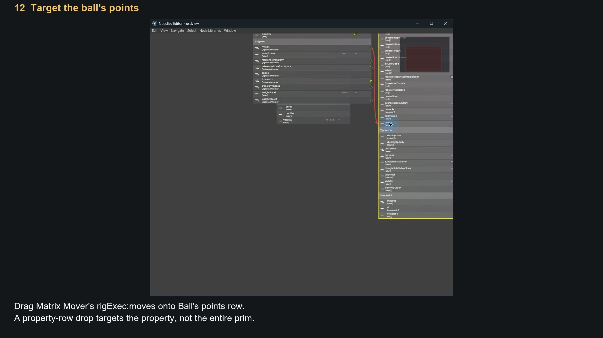

*Movie frame: 1:43.*

## 13. Create the rolling calculation — 1:45

Select **RigExecRoot1** in the prim tree, focus Noodles, and choose
**Tab → RigExecFloatMathMover**. This will turn travel distance into a
rotation angle.

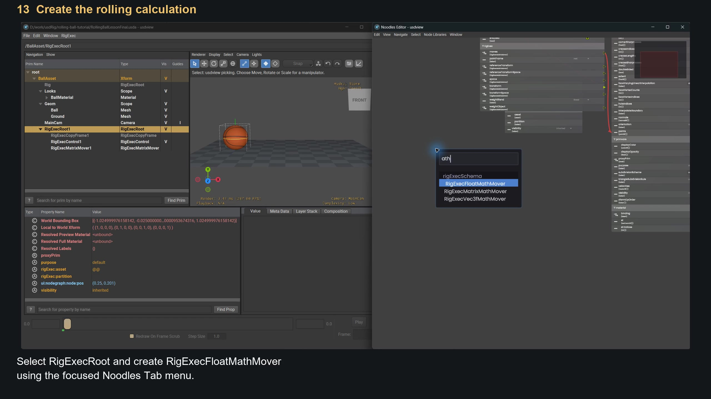

*Movie frame: 1:52.*

## 14. Apply the mover API — 1:54

Select the **Float Math Mover node**, then choose **Tab → RigExecMoverAPI**,
just as you did for the Matrix Mover.

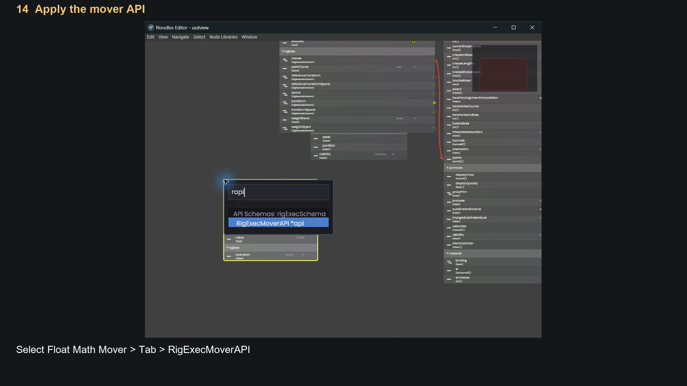

*Movie frame: 1:58.*

## 15. Use multiplication — 2:00

On the Float Math Mover, set **rigExec:operation** to **multiply**.

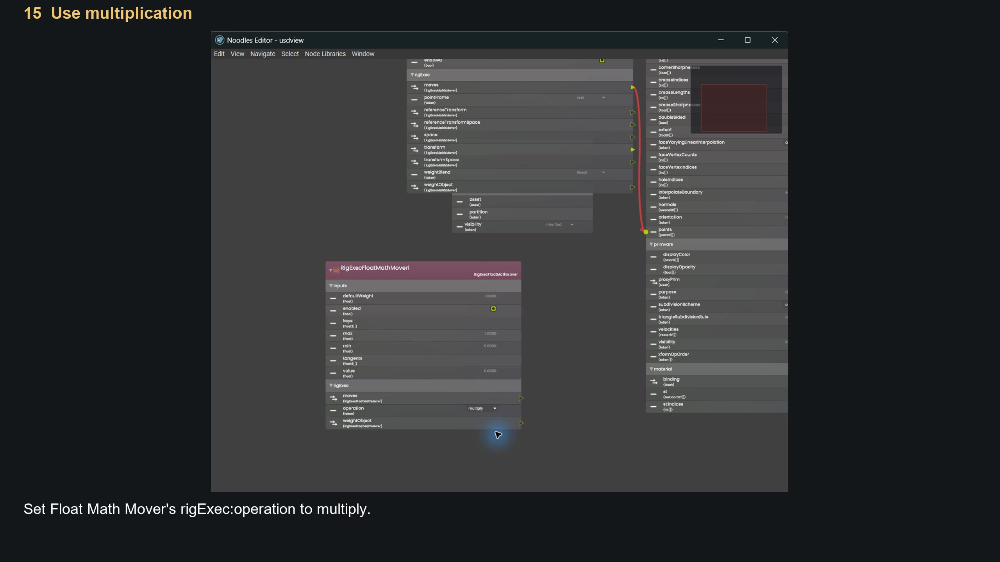

*Movie frame: 2:05.*

## 16. Target Z rotation — 2:07

Expand the control's **avars** group. Drag the Float Math Mover's
**rigExec:moves** socket onto the control's **avars:rz property row**.
This is the channel the calculation will drive.

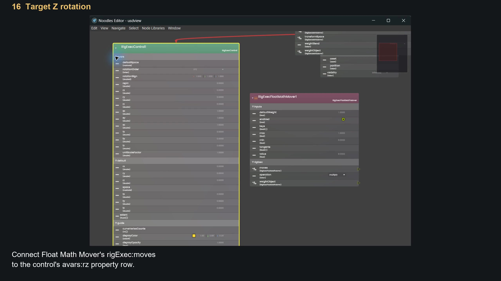

*Movie frame: 2:14.*

## 17. Set the rolling factor — 2:16

On the **control**, set **avars:rz** to `-57.2958` and press **Enter**.
The Float Math Mover multiplies this authored base value by its input.
For a radius-one ball, that converts each unit of X travel into the right
number of degrees of Z rotation:

`angle in degrees = -distance / radius × 180 / pi`

The minus sign makes positive X travel roll in the correct direction.
The next connection supplies the distance; you won't need to key the roll.

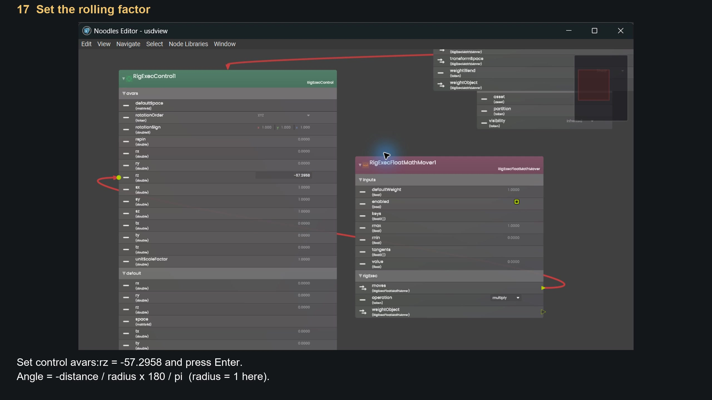

*Movie frame: 2:28.*

## 18. Feed travel into the calculation — 2:31

Drag from the Float Math Mover's **inputs:value** to the control's
**avars:tx property row**. The blue wire is an attribute connection:
X travel now feeds the multiplication.

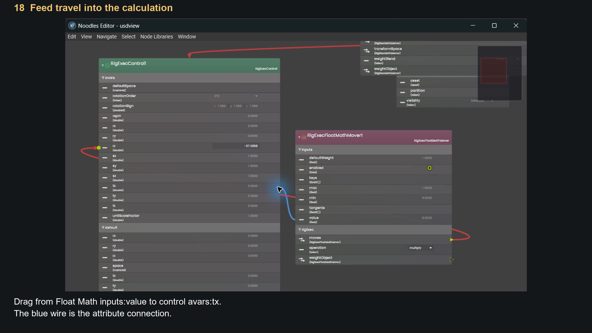

*Movie frame: 2:39.*

## 19. Test the rig interactively — 2:41

Change or drag the control's **avars:tx** value. The ball should move and
roll together; reversing the travel reverses the rotation. Watch the seams
to make the turn easy to see.

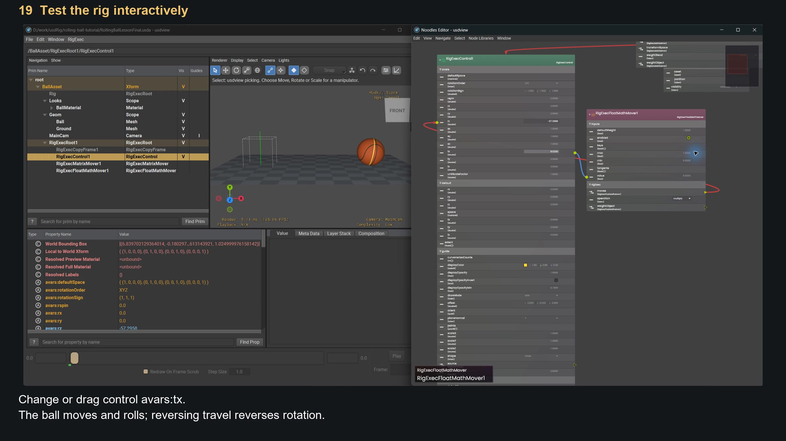

*Movie frame: 2:49.*

## 20. Roll the ball with the viewport Move tool — 2:52

Select **RigExecControl1** in the prim tree, then click the viewport's
**Move** tool. Drag the **red X arrow** slowly across the floor. The gizmo
moves the control, and the ball rolls as you drag.

At **2:58**, the movie cuts closer and shows a continuous drag at half speed.
Watch the seams rotate while the control changes position. This rig maps
straight-line X travel to Z rotation; it is ready for you to animate that
travel channel.

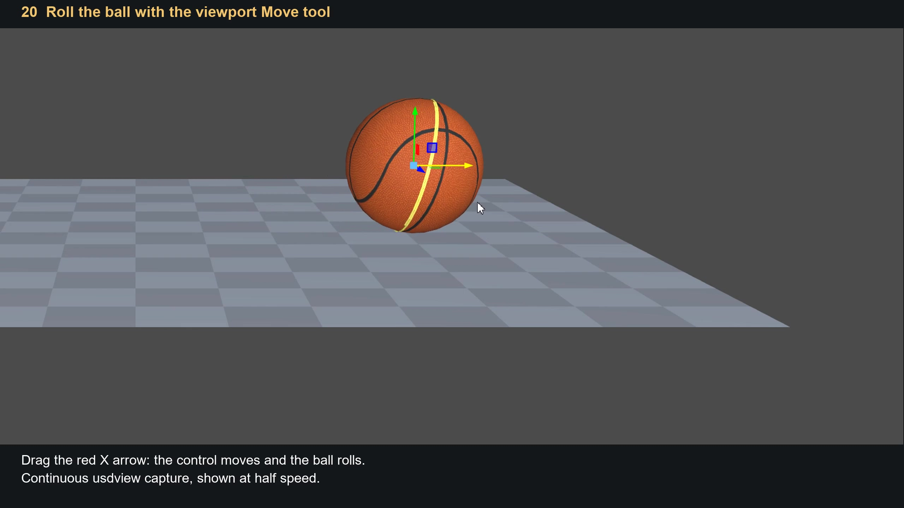

*Movie frame: 3:03, during the continuous viewport drag.*

## 21. Save the root layer — 3:06

Restore the control's **avars:tx** to `0`. Focus Noodles and press
**Ctrl+S** to save. Your lesson root layer now holds the sublayer arc and
the rig you built around the ball.

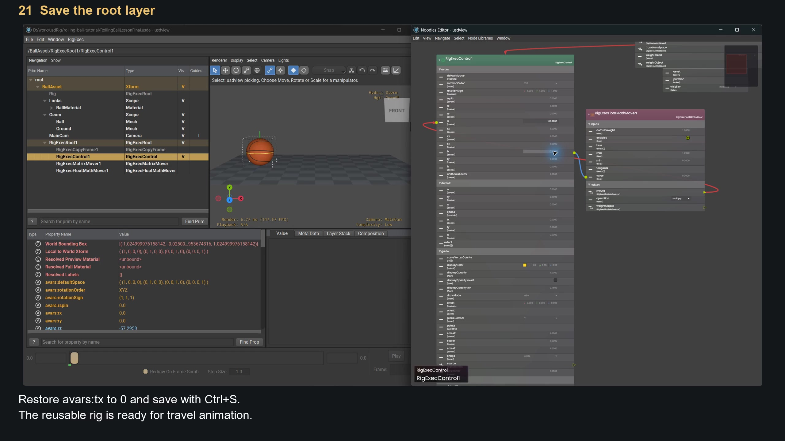

*Movie frame: 3:11.*

## Check your connections

| Node | Property | Target or value |
|---|---|---|
| Control | `rest:ty` | `1` |
| Control | `avars:rz` | Authored base value `-57.2958` |
| Matrix Mover | `rigExec:transform` | Control prim (drop on its title) |
| Matrix Mover | `rigExec:moves` | `Ball.points` |
| Float Math Mover | `rigExec:operation` | `multiply` |
| Float Math Mover | `rigExec:moves` | Control's `avars:rz` |
| Float Math Mover | `inputs:value` | Connected to control's `avars:tx` |

Both movers need **RigExecMoverAPI**. If a wire lands on a node title when
you meant to target a channel, reconnect it to the named property row.
If Tab does nothing, click inside Noodles and try again.

For more detail, see [Control](../nodes/control.md),
[Matrix Mover](../nodes/matrix_mover.md), and
[Float Math Mover](../nodes/float_math_mover.md). The separate
[Godot and baked rigs tutorial](tutorial-godot-baked-rig.md) uses a more
complex ball rig with joints and independent rotation controls for changing
travel direction; its finished source is a different example from this lesson.
