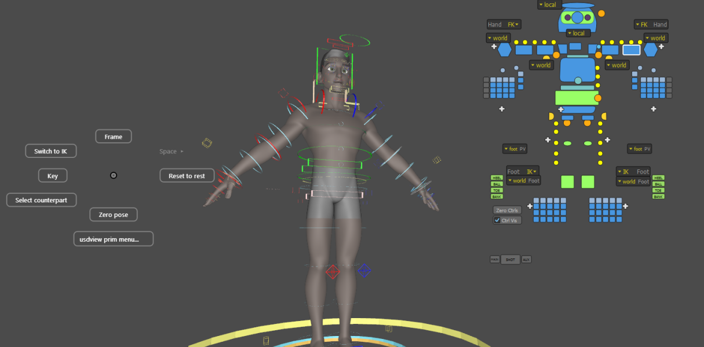

OpenUSD 26.08 · 0.1 alpha

# Character rigs that evaluate inside USD

RigExec evaluates controls, solvers, constraints
and deformers in memory, without changing the stage, and publishes the
posed character through Hydra for live playback in <code>usdview</code>
and other viewers.

[Get started](guide/getting-started.md){ .md-button .md-button--primary }
[Browse the nodes](index.md){ .md-button }

## What it does

-   :material-transit-connection-variant:{ .lg .middle } **Rigs as USD**

    ---

    A rig is a piece of namespace under one `RigExecRoot`. Where a prim
    sits decides when it runs, so the hierarchy reads like the evaluation
    order.

    [:octicons-arrow-right-24: How operators fire](concepts/how-operators-fire.md)

-   :material-speedometer:{ .lg .middle } **Dynamic and baked**

    ---

    Evaluate through OpenExec while authoring, or through a baked program
    built for playback. Both share the same math kernels and produce the
    same pose.

    [:octicons-arrow-right-24: Baked and dynamic](concepts/baked-vs-dynamic.md)

-   :material-vector-polyline:{ .lg .middle } **Solvers and deformers**

    ---

    FK, two-bone and spline IK, constraints, skinning, blend shapes,
    lattices, Delta Mush, wrinkles and more: each one a documented node.

    [:octicons-arrow-right-24: Node reference](index.md)

-   :material-gesture-tap:{ .lg .middle } **Animator tools**

    ---

    Pick controls from the character's own picker, from TouchPose regions
    on the skin, or from a right-click marking menu, with IK/FK switching
    that never moves the pose.

    [:octicons-arrow-right-24: Animator tools](tools/index.md)

-   :material-cached:{ .lg .middle } **Frame cache**

    ---

    Frames warm in the background and play back from memory, while edits
    reach the viewport immediately.

    [:octicons-arrow-right-24: What warming does](concepts/frame-cache-warming.md)

-   :material-package-variant-closed:{ .lg .middle } **Beyond usdview**

    ---

    Export a rig to the `.rigexec` binary and play it with a standalone
    runtime that links no USD library.

    [:octicons-arrow-right-24: Standalone runtime](specs/standalone-runtime.md)

## Every node, animated

Each node page carries a small animated stage that plays in `usdview`.
These are rendered straight from them.

  <a href="nodes/two_bone_ik/">Two-bone IK</a>
  <a href="nodes/spline_ik/">Spline IK</a>
  <a href="nodes/curve_mover/">Curve mover</a>
  <a href="nodes/blendshape_mover/">Blend shapes</a>

## Two ways to evaluate, one pose

## Status

RigExec is an early, end-to-end vertical under active development: APIs,
behaviour and file formats may change without notice. It builds against an
unmodified OpenUSD 26.08 with OpenExec. Original project code is MIT
licensed; third-party material keeps its own terms.
