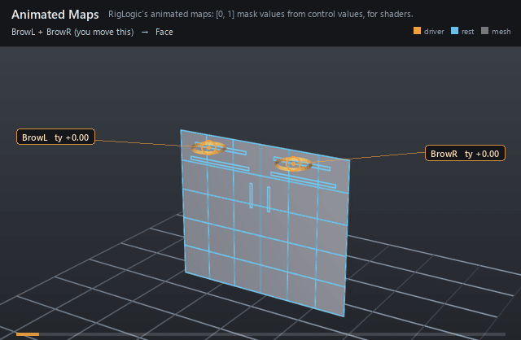

#  Animated Maps

*RigLogic's animated maps: [0, 1] mask values from control values, for shaders.*

| | |
|---|---|
| **Node type** | `RigExecAnimatedMaps` |
| **Example** | [animated_maps.usda](../examples/animated_maps.usda) |

On this page:

- [Overview](#overview)
- [How it works](#how-it-works)
- [Wiring](#wiring)
- [Parameters](#parameters)
- [Example](#example)
- [Tips](#tips)
- [See also](#see-also)

## Overview



Animated maps turn control values into texture-mask intensities --
the wrinkle maps a face shader blends in as a brow raises. Each
`RigExecAnimatedMap` child is a conditional table over the input properties;
its value is published on `outputs:value`, connectable like a pose weight, and
as a constant float primvar on every `rigExec:meshes` target so a shader can
read it. The tables are Epic Games RigLogic's, ported from OpenRigLogic (MIT,
RigLogic 13.5.0); see [algorithm references](../references.md) and
[RigLogic behaviours](../concepts/riglogic.md).

RigLogic's animated maps (Epic Games OpenRigLogic, see
docs/references.md): one value in [0, 1] per RigExecAnimatedMap child,
each a sum of piecewise-linear segments of the input properties, made
for driving texture masks such as wrinkle maps.

Like a pose interpolator it is not a mover: it publishes a float per
child on outputs:value, which a RigExecBlendInput's inputs:weight or any
reader of a pose weight can connect to. For shaders, each map is also
published as a constant float primvar on every rigExec:meshes target,
named by its rigExec:primvarName. The primvar is display output: it
reaches Hydra and is never written to the stage.

## How it works

The node runs in the pose domain like a pose interpolator. Each
row of a map reads one input x and adds `slope * x + cut` when x lies in its
`[from, to]` interval (a reversed interval is swapped); among consecutive rows
on the same input only the first matching interval contributes, so
neighbouring segments that share an endpoint count it once. The sum is clamped
to [0, 1] (`libs/rigExecMath/conditionalTableKernel.h`). Each map's value is
published on its `outputs:value` and copied to
`<mesh>.primvars:<rigExec:primvarName>`, which imaging hands to Hydra as a
constant float primvar and never writes to the stage. A glslfx shader sees it
only if its attributes block names it.

## Wiring

| Relationship | Points to | Required |
|---|---|---|
| `rigExec:driverAttributes` | The float or double input properties rows index. | yes |
| `rigExec:meshes` | Meshes that receive every map as a primvar. | no |
| `RigExecAnimatedMap` children | One per map. | yes |

## Parameters

### Node parameters

#### `rigExec:driverAttributes`

*Relationship.*

The input properties, float or double, in order: a row's
rigExec:rowInputs entry is an index into this list.

#### `rigExec:meshes`

*Relationship.*

Meshes that receive every map as a constant float primvar,
primvars:<rigExec:primvarName>.

#### `inputs:enabled`

*Type:* `bool`. *Default:* `true`.

Shape-preserving enable. Disabled maps publish zero.

## Example

Two brow controls slide in ty from -1 (lowered) to 1 (raised). The
`Wrinkles` node reads both and publishes three maps. `foreheadL` and
`foreheadR` are one row each, slope 1 over [0, 1] on their own brow. `frown`
has a row per brow over the reversed interval [0, -1] with slope -0.6, so one
lowered brow reads 0.6 and both clamp at 1. Each map's `outputs:value` is
connected to a blend channel on the face card, so the brows lift and knit
with the maps. Every map is also published as a constant float primvar on each
`rigExec:meshes` target; the wrinkle-line cards read theirs through a
`UsdPrimvarReader_float` into `UsdPreviewSurface` opacity, so the lines fade
in wherever scene materials are drawn, and nothing is written to the
stage.

Open it live with:

```bat
bin\launch_usdview.bat docs\examples\animated_maps.usda
```

Re-render the GIF above with:

```bat
python docs/render_media.py --page animated_maps
```

## Tips

- Rows on the same input should be consecutive and ordered: only the first interval that holds the input counts within such a run.
- Rows, inputs and meshes are compiled rig identity; the inputs' values are per-frame inputs.
- Disabling the node publishes zero on every map and primvar.

## See also

- [Animated Map](animated_map.md)
- [Pose Interpolator](pose_interpolator.md)
- [Surface Projector](surface_projector.md)

---

[UsdRig](../index.md)
