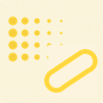

#  Capsule Weight

*A tube of influence along a bone: falloff about the segment to a child joint.*

| | |
|---|---|
| **Node type** | `RigExecCapsuleWeight` |
| **Example** | [capsule_weight.usda](../examples/capsule_weight.usda) |

On this page:

- [Overview](#overview)
- [How it works](#how-it-works)
- [Wiring](#wiring)
- [Parameters](#parameters)
- [Example](#example)
- [Tips](#tips)
- [See also](#see-also)

## Overview


A placed volume whose field is the distance to a SEGMENT: from the
volume's own origin to the posed origin of its end provider. Authored
inside a joint with nothing wired, the segment runs to that joint's
first `RigExecJoint` child in namespace order — the same rule a bone's
tip follows — so one capsule per bone covers exactly that bone, and
`rel rigExec:segmentEnd` names any other `RigExecXformable` when the end
should be explicit. The field is fully on within `inputs:falloffMin` of
the segment and off at `inputs:falloffMax`: the iso-surfaces are
capsules, two hemispherical caps joined by a tube, and per-axis
`inputs:scaleX/Y/Z` make the tube elliptical. With no end at all the
segment has zero length and the capsule is a sphere.

Falloff about a segment: d is the distance from a point to the
nearest point of the segment from the volume's placed origin to its
segment end, measured in rigid volume-local space after
inputs:scaleX/Y/Z. The field
is 1 within inputs:falloffMin of the segment and falls to 0 at
inputs:falloffMax, so the iso-surfaces are capsules: two hemispherical
caps joined by a tube, elliptical when the scales differ.

The segment end is a FRAME, not a stored offset: it is the posed origin
of the provider rigExec:segmentEnd names, or, when that relationship
names nothing, of the first RigExecJoint child (in namespace order) of
the volume's namespace-parent joint. Authored under a joint, the capsule
therefore spans that joint's segment to its child and follows the
child's live frame, so scaling the parent joint along its length
stretches the capsule with it. With no end at all the segment has zero
length and the field is a sphere about the origin.

## How it works

The prim publishes a weight packet that the bound mover consumes as
its envelope during the geometry (point-chain) phase, like every volume
weight. Each evaluation it takes its own posed frame, strips scale and
shear so the field matches the rigid guide that is drawn, and reads the
END PROVIDER'S frame in the same phase: the end is a second provider
slot the compiled rig binds (the default child resolved once at
compile), not a stored offset, so when the parent joint stretches
along its length with `avars:sx` the child's origin moves and the
segment follows it. Both the points and the end are carried into the
capsule's local frame and divided by `inputs:scaleX/Y/Z`; `d` is then
the distance from each point of `rigExec:weightTarget` (or of
`rigExec:sampleSource`) to the nearest point of the segment, remapped
across the band, exchanged by `inputs:invert`, run through the
falloff lookup table, multiplied by `inputs:strength`, and bounded by
`rigExec:rangePolicy`. The `rigExecReadPhase` metadata on
`rigExec:weightTarget` chooses the measured points exactly as for a
sphere: `base` (the default) measures the static bind points,
`preceding` the points as they stand in the mover stack.

## Wiring

| Relationship | Points to | Required |
|---|---|---|
| `rigExec:weightTarget` | Exact points property this generated field covers; must be the same target the bound mover moves. | yes |
| `rigExec:segmentEnd` | Optional single provider whose posed origin ends the segment; absent, the first `RigExecJoint` child of the namespace-parent joint. More than one target is a compile error. | no |
| `rigExec:sampleSource` | Static points to measure against instead of the target. The weighted domain stays the target. | no |
| (placement) | No wiring: the volume follows its namespace-parent xformable when unwired, as every volume weight does. | - |
| (bound by) | A mover's `rigExec:weightObject` applies this field. | - |

## Parameters

### Volume weight

#### `purpose`

*Type:* `uniform token`. *Default:* `"guide"`.

Render purpose, overriding UsdGeomImageable's `default`
fallback for the same reason RigExecJoint does: an influence
volume is a DIAGNOSTIC, drawn when a viewer asks for guides, and
the stock attribute keeps the drawing and the bounds from
disagreeing.

#### `rigExec:weightTarget`

*Relationship.*

Canonical prim or exact property carrying the weighted
domain.

Its rigExecReadPhase metadata chooses which points the distance
function measures. `base`, the default, samples the AUTHORED
points (or rigExec:sampleSource) rather than any mover's output,
so one field per evaluation is shared by every mover that binds
the weight and a point keeps the weight its bind pose earned --
the behaviour of a painted map, and what a matrix mover wants so
that its own output cannot feed back into its own weights.

`preceding` samples the points AS THEY STAND at the consuming
operation's position in the mover stack, so the volume grabs
whatever is inside it right now. That is the dynamic behaviour, and
it is order dependent by construction: the same volume placed at
two points in the stack legitimately yields two different fields.
`final` and checkpoint paths follow the ordinary read-phase rules;
`final` on the consuming mover's own target includes that mover's
output and is reported as an operation cycle.

#### `rigExec:representation`

*Type:* `uniform token`. *Default:* `"dense"`.

Valid values: `dense`.

A generated field has a value at every element, so dense
is the only representation it can honestly publish. Declared
anyway, and rejected rather than coerced when authored otherwise,
because the packet contract carries it and a combine has to match
representations across its inputs.

#### `rigExec:rangePolicy`

*Type:* `uniform token`. *Default:* `"clamp"`.

Valid values: `strict`, `clamp`.

Defaults to clamp rather than the strict used by the
authored weight objects: inputs:strength and inputs:invert are
animatable, and an artist scrubbing strength past one should see
the field saturate, not have the packet invalidated and its mover
pass through mid-drag.

#### `inputs:falloffMin`

*Type:* `float`. *Default:* `0`.

Distance at which the field is fully ON. In the volume's
local units after inputs:scaleX/Y/Z, so for a sphere it is simply
the inner radius.

#### `inputs:falloffMax`

*Type:* `float`. *Default:* `1`.

Distance at which the field is fully OFF; the outer
radius for a sphere.

falloffMax < falloffMin is legal and flips the ramp -- the signed
denominator does it with no special case. falloffMax exactly
equal to falloffMin is the one degenerate case, and means a hard
step at that distance.

#### `inputs:invert`

*Type:* `float`. *Default:* `0`.

Exchanges the two ends of the band. A float rather than a
bool so it can be animated or driven like any other avar: it
LERPS between the two ramps, so an animated invert sweeps through
a flat field at 0.5 instead of popping.

#### `inputs:strength`

*Type:* `float`. *Default:* `1`.

Final multiplier on the remapped weight. Deliberately not
clamped by the kernel -- rigExec:rangePolicy is the authority on
out-of-range weights, and silently clamping here would hide a
strict-policy violation.

#### `rigExec:falloffProfile`

*Type:* `uniform token`. *Default:* `"smooth"`.

Valid values: `linear`, `smooth`, `easeIn`, `easeOut`, `constant`, `curve`.

Named analytic remap of the normalized band parameter, or
`curve` to use the spline authored on rigExec:falloffCurve. Every
profile pins f(0) = 0 and f(1) = 1, so switching profiles never
moves the band's endpoints -- only its shape between them.

The presets are baked to the same lookup table the curve is
resampled into, so there is exactly one remap path in the hot
loop whether the author picked a preset or drew a curve.

#### `inputs:falloffSamples`

*Type:* `float[]`. *Default:* `[]`.

Optional uniformly spaced samples of the normalized falloff
profile, from the outer boundary (0) to the inner boundary (1).
A nonempty array replaces falloffProfile and falloffCurve; an empty
array uses that authored profile. Editors may preview this input
without authoring it, then commit the custom spline on release.

#### `rigExec:falloffCurve`

*Type:* `float`. *Default:* `0`.

Falloff shape as an authored Ts spline over x in [0, 1],
read when rigExec:falloffProfile is `curve`. x is the ramp
parameter -- 1 at falloffMin, 0 at falloffMax -- and the value is
the weight.

This is a STRUCTURAL read, resampled to a lookup table once per
compiled rig, NOT a per-frame input: a per-frame input is a
value at one time, and a curve is the whole function. The animatable knobs are falloffMin/Max, invert, and
strength; the curve is a rig-authoring parameter, which is also
what keeps the field fixed-shape.

Held extrapolation outside [0, 1] is the Ts default and is
exactly right here, so a curve authored over a shorter span still
yields a total field.

#### `rigExec:sampleSource`

*Relationship.*

Optional explicit points source to measure against,
overriding rigExec:weightTarget for SAMPLING only. The weighted
domain stays the weightTarget, so this is how a volume weights one
mesh by another mesh's shape -- typically an unposed reference
copy -- and its point count must match the weightTarget's. Without
rigExecReadPhase metadata it reads the authored points; a declared
phase selects that version. Ignored when rigExec:weightTarget
declares a phase other than `base`.

#### `guide:weightDisplay`

*Type:* `uniform token`. *Default:* `"tint"`.

Valid values: `tint`, `heatmap`, `bands`.

Selected influence overlay: tint blends gray to red;
heatmap interpolates dark blue, blue, teal, yellow and red at weights
0, .25, .5, .75 and 1. bands assigns five colors in .2-wide bins.
Colors use resolved vertex weights, clamped to [0,1] for display;
faces interpolate them, so bands are approximate on coarse meshes.
Does not change weights, materials or opacity on the source stage.

#### `guide:drawMode`

*Type:* `uniform token`. *Default:* `"falloff"`.

Valid values: `falloff`, `cage`, `brackets`, `shell`, `wire`, `geometry`, `none`.

falloff draws a soft inner shell at falloffMin with
continuous inner rings and a dashed exterior cage at falloffMax.
A zero inner radius draws only the exterior cage.
cage draws a continuous inner boundary and dashed outer
boundary without fill. brackets draws short cardinal sections of
both boundaries. shell adds a faint outer surface to continuous
rings. These styles use 30% of guide:wireWidth and at most five
cross-section rings along a curve. wire draws the falloffMin and falloffMax iso-surfaces as
curves, widthed by guide:wireWidth. A sphere weight in wire mode
draws the falloffMin surface, the max-weight interior, as geometry
at 50% opacity with dotted great-circle rings on it, and the
falloffMax surface as a dotted wire. geometry draws every
iso-surface solid; none suppresses the guide without disturbing
the field.

#### `guide:wireWidth`

*Type:* `double`. *Default:* `0.05`.

Width of the drawn wire guide curves; see RigExecControl.

#### `guide:displayColor`

*Type:* `color3f`. *Default:* `(1.0, 0.2, 0.2)`.

Red by convention, matching the influence overlay the
results scene index paints onto the weighted geometry so the
volume and the region it grabs read as one object.

#### `guide:displayOpacity`

*Type:* `float`. *Default:* `0.35`.

### Transform provider

#### `rest:tx`

*Type:* `double`. *Default:* `0`.

#### `rest:ty`

*Type:* `double`. *Default:* `0`.

#### `rest:tz`

*Type:* `double`. *Default:* `0`.

#### `rest:rx`

*Type:* `double`. *Default:* `0`.

#### `rest:ry`

*Type:* `double`. *Default:* `0`.

#### `rest:rz`

*Type:* `double`. *Default:* `0`.

#### `rest:space`

*Type:* `matrix4d`. *Default:* `( (1, 0, 0, 0), (0, 1, 0, 0), (0, 0, 1, 0), (0, 0, 0, 1) )`.

Bind transform relative to the namespace frame provider's rest frame, applied after the rest:tx/ty/tz/rx/ry/rz offsets; always orthonormalized. A plain Xformable between the provider and that frame provider is composed in after it. A provider with no RigExec ancestor and no such Xformable resolves against identity, so its rest:space is its local-to-world bind transform.

#### `default:tx`

*Type:* `double`. *Default:* `0`.

#### `default:ty`

*Type:* `double`. *Default:* `0`.

#### `default:tz`

*Type:* `double`. *Default:* `0`.

#### `default:rx`

*Type:* `double`. *Default:* `0`.

#### `default:ry`

*Type:* `double`. *Default:* `0`.

#### `default:rz`

*Type:* `double`. *Default:* `0`.

#### `default:space`

*Type:* `matrix4d`. *Default:* `( (1, 0, 0, 0), (0, 1, 0, 0), (0, 0, 1, 0), (0, 0, 0, 1) )`.

Local-to-world zero position for posing. Its computed fallback
is compose(default translation/XYZ rotation) * rest * inverse(parent
rest) * parent:defaultSpace. The rest is unaffected by default edits.
A connection is authoritative, including identity. Otherwise a
non-identity authored matrix overrides the computed fallback; an
identity value selects that fallback.

#### `posed:space`

*Type:* `matrix4d`. *Default:* `( (1, 0, 0, 0), (0, 1, 0, 0), (0, 0, 1, 0), (0, 0, 0, 1) )`.

Final local-to-world transform. For a joint a solver
writes, this is supplied by the compiler's solver binding; it may
also be authored or
connected directly. Unwired xformables follow the parent chain
with rest offsets and avars.

#### `posed:defaultSpace`

*Type:* `matrix4d`. *Default:* `( (1, 0, 0, 0), (0, 1, 0, 0), (0, 0, 1, 0), (0, 0, 0, 1) )`.

Controller-adjusted zero pose; falls back to avars:defaultSpace.
Used by the local-avars pose path before parent motion. A connection
overrides the fallback, as does a non-identity authored matrix.

#### `avars:tx`

*Type:* `double`. *Default:* `0`.

#### `avars:ty`

*Type:* `double`. *Default:* `0`.

#### `avars:tz`

*Type:* `double`. *Default:* `0`.

#### `avars:rx`

*Type:* `double`. *Default:* `0`.

#### `avars:ry`

*Type:* `double`. *Default:* `0`.

#### `avars:rz`

*Type:* `double`. *Default:* `0`.

#### `avars:rspin`

*Type:* `double`. *Default:* `0`.

#### `avars:rotationOrder`

*Type:* `token`. *Default:* `"XYZ"`.

Valid values: `XYZ`, `XZY`, `YXZ`, `YZX`, `ZXY`, `ZYX`.

#### `avars:defaultSpace`

*Type:* `matrix4d`. *Default:* `( (1, 0, 0, 0), (0, 1, 0, 0), (0, 0, 1, 0), (0, 0, 0, 1) )`.

Zero pose supplied to avar evaluation; falls back to the
computed default:space. A connection or non-identity authored matrix
selects another zero pose.

#### `avars:unitScaleFactor`

*Type:* `double`. *Default:* `1`.

Multiplier converting translation avars into local distance units before the selected default and parent transforms. Rotations and scales are unaffected.

#### `avars:rotationSign`

*Type:* `double3`. *Default:* `(1, 1, 1)`.

Per-axis sign applied to rx, ry and rz -- and to rspin,
which is an X rotation -- before they are composed. Each component
carries a sign and nothing else: a magnitude is discarded, and
anything that is not negative, including zero, selects +1. Zero
would otherwise erase an axis, so it resolves to the unmirrored
answer rather than a collapsed one.

This is how a MIRRORED limb is declared: the same rotation value
moves both sides symmetrically. A mirror expressed as a negative
scale cannot survive into a rest frame here -- it would make the frame
left-handed and every joint, driver and bind below it would have
to be rebuilt to match -- so the mirror is declared on the avars
instead, where it belongs: it says which of this control's axes
already point the mirrored way and which answer backwards.

Identity at rest, and that is the point. A sign changes nothing
when the avars are zero, so declaring it cannot move the rest
pose, the skin, or anything constrained to this control. Only
what the animator types changes meaning.

Applied to the avar, not to the frame, so the control's own posed
frame mirrors too and a manipulator turns with the limb rather
than against it.

#### `parent:space`

*Type:* `matrix4d`. *Default:* `( (1, 0, 0, 0), (0, 1, 0, 0), (0, 0, 1, 0), (0, 0, 0, 1) )`.

Selected parent's posed local-to-world space. Falls back to
the nearest namespace provider's computePointFrame; identity when
there is none. Connections (including identity) or a non-identity
authored matrix select a different parent space.

#### `parent:defaultSpace`

*Type:* `matrix4d`. *Default:* `( (1, 0, 0, 0), (0, 1, 0, 0), (0, 0, 1, 0), (0, 0, 0, 1) )`.

Selected parent's default local-to-world space. Falls back
to the nearest namespace provider's computeDefaultFrame. Connections
(including identity) or a non-identity authored matrix override it.
The avar pose is avars * posed:defaultSpace * inverse(parent:defaultSpace)
* parent:space, in row-vector convention.

### Node parameters

#### `inputs:falloffMin`

*Type:* `float`. *Default:* `0`.

Distance from the segment at which the field is fully ON,
in the capsule's local units after inputs:scaleX/Y/Z: the inner
radius of the capsule.

#### `inputs:falloffMax`

*Type:* `float`. *Default:* `1`.

Distance from the segment at which the field is fully OFF:
the outer radius of the capsule. See RigExecVolumeWeight for a
reversed or degenerate band.

#### `inputs:scaleX`

*Type:* `float`. *Default:* `1`.

Per-axis divisor applied to the local coordinate, and to the
segment end, before the distance, making the tube elliptical; see
RigExecSphereWeight.

#### `inputs:scaleY`

*Type:* `float`. *Default:* `1`.

#### `inputs:scaleZ`

*Type:* `float`. *Default:* `1`.

#### `rigExec:segmentEnd`

*Relationship.*

Optional single RigExecXformable whose posed origin is the
far end of the segment. When it names nothing the end is the first
RigExecJoint child, in namespace order, of the volume's
namespace-parent joint; a parent that is no joint, or a joint with
no joint child, leaves a zero-length segment (a sphere). The end is
read as a frame every evaluation, so an animated end moves the
segment; naming more than one target is a compile error.

## Example

A 9 x 3 quad plank is lifted by one matrix mover whose joint holds a
static one-unit rise. The field gating it is a capsule authored inside
the UpperArm joint with no `rigExec:segmentEnd`, so it spans UpperArm to
its child Forearm, three units along the plank. The only spline in the
file is UpperArm's `avars:sx`: the stretch carries Forearm out to 4.5
and back, the capsule's end follows Forearm's live frame, and the raised
band grows and shrinks with round ends that stay round — the capsule's
own placement drops the stretch, so the tube does not fatten. The inner
capsule is `inputs:falloffMin` 0.4, where the plank is lifted the whole
unit, and the outer one `inputs:falloffMax` 1.2, where it is not lifted
at all; `linear` between them.

Open it live with:

```bat
bin\launch_usdview.bat docs\examples\capsule_weight.usda
```

Re-render the GIF above with:

```bat
python docs/render_media.py --page capsule_weight
```

## Tips

- Author one capsule inside each bone that should own a region: with no relationship it ends at the bone's first joint child, so adding, removing or reordering that child moves the segment and recompiles the rig.
- Size the tube with `inputs:falloffMin`/`inputs:falloffMax` and `inputs:scaleX/Y/Z`; a scale in the transform is removed before the field is built. The segment's LENGTH comes from the end provider alone.
- A leaf joint with no joint child has no segment: its capsule is a sphere about the joint. Give a drawn leaf bone an `End` joint child when its capsule should reach its tip.
- Inside the influences of a Skin Mover, capsules are the source of its authored rows: `rigexec.binding.generate_skin_weights` measures them at the setup pose and normalises per point.

## See also

- [Sphere Weight](sphere_weight.md)
- [Curve Weight](curve_weight.md)
- [Skin Mover](skin_mover.md)
- [Joint](joint.md)

---

[UsdRig](../index.md)
