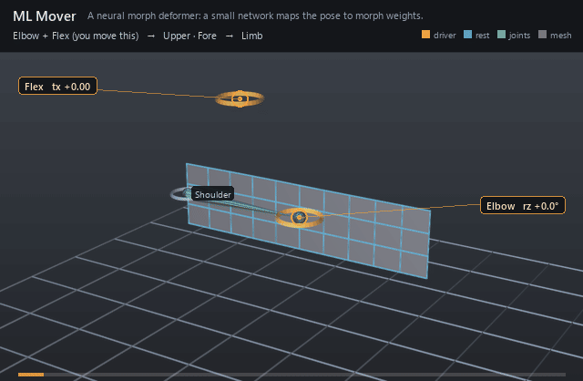

#  ML Mover

*A neural morph deformer: a small network maps the pose to morph weights.*

| | |
|---|---|
| **Node type** | `RigExecMlMover` |
| **Example** | [ml_mover.usda](../examples/ml_mover.usda) |

On this page:

- [Overview](#overview)
- [How it works](#how-it-works)
- [Wiring](#wiring)
- [Parameters](#parameters)
- [Example](#example)
- [Tips](#tips)
- [See also](#see-also)

## Overview



The ML mover is a learned corrective. A multilayer perceptron
reads the rig's pose -- each driver joint's local rotation from rest as a
quaternion, then any number of float properties -- and produces one weight per
`RigExecMlOutput` child. Those weights drive sparse morph targets added to the
moved points, so a trained network can supply the folds and bulges a linear
skin cannot. The network is Epic Games RigLogic's machine-learned behavior
(dense layers with linear, relu, leaky relu, tanh or sigmoid activations, and
its region mask), ported from OpenRigLogic (MIT, RigLogic 13.5.0); see
[algorithm references](../references.md) and
[RigLogic behaviours](../concepts/riglogic.md) for what was ported and what
was added.

A neural morph deformer: a multilayer perceptron maps the rig's
pose to one weight per RigExecMlOutput child, and those weights drive
sparse morph targets added to the moved points.

The network is RigLogic's (Epic Games OpenRigLogic, see
docs/references.md): dense layers, each a row-major weight matrix with
one row per output unit, a bias, and a linear, relu, leakyRelu, tanh or
sigmoid activation. Its input row is each rigExec:driver's local rotation
from rest as (x, y, z, w) on the w >= 0 hemisphere -- measured exactly as
a pose interpolator measures its driver -- followed by each
rigExec:driverAttributes value as read.

Two halves, one prim. The network publishes each output's weight as
that child's outputs:weight, which anything can read the way it reads a
RigExecPose weight. The mover half is a blend-shape revision of the
points it moves: its rigExec:blendInputs are ordinary RigExecBlendInput
channels, normally one per output with inputs:weight connected to it and
one RigExecBlendSample naming a UsdSkelBlendShape, so the morphs are
sparse offsets and the common MoverAPI envelope applies to their sum.

## How it works

One prim, two halves, both in the shared operation graph. The
network runs in the pose domain beside pose interpolators: it reads each
driver's final and rest frames (and its nearest joint or control ancestor's),
forms `(restLocal^-1 * local)` per driver exactly as an interpolator does,
puts each rotation on the w >= 0 hemisphere as (x, y, z, w), appends the
numeric inputs, normalizes them by `rigExec:inputMean`/`rigExec:inputScale`,
and evaluates the layers (`libs/rigExecMath/mlpKernel.h`). `inputs:mask` at
exactly zero publishes `rigExec:outputDefaults` without running the network;
any other mask multiplies every output. Each output is published as its
child's `outputs:weight`. The mover half is a blend-shape revision of
`rigExec:moves`: its `rigExec:blendInputs` connect to those outputs and name
UsdSkelBlendShape samples, so the morphs are sparse offsets and the common
mover envelope scales their sum. The frame cache and the `.rigexec` runtime
run the same kernel and the same blend revision.

## Wiring

| Relationship | Points to | Required |
|---|---|---|
| `rigExec:moves` | One native mesh points property. | yes |
| `rigExec:driver` | Joints or controls, four inputs each, in order. | no |
| `rigExec:driverAttributes` | Float or double properties, one input each, after the joints. | no |
| `RigExecMlOutput` children | One per network output, in namespace order. | yes |
| `rigExec:blendInputs` | Blend channels whose `inputs:weight` connects to an output, each with a `RigExecBlendSample` naming a UsdSkelBlendShape. | yes |

## Parameters

### Common mover envelope

#### `rigExec:moves`

*Relationship.*

Reserved write-set relationship: exact prim/property targets.

#### `inputs:enabled`

*Type:* `bool`. *Default:* `true`.

Shape-preserving enable. Disabled movers pass their preceding
revision through unchanged (value-only edit).

#### `inputs:defaultWeight`

*Type:* `float`. *Default:* `1`.

Normalized common mover envelope in [0, 1]. With no bound
rigExec:weightObject it broadcasts over every logical element: zero
passes the incoming value through bit-for-bit and one applies the
mover's full-strength result.

#### `rigExec:weightObject`

*Relationship.*

Optional compatible total weight field, at most one target.
When bound, the weight object's values (including its own sparse or
constant fallback) supply the common envelope instead of
inputs:defaultWeight. Target, domain, and cardinality must match each
mover application; an incompatible binding is a compile error. A
multi-target mover may bind only a constant operation envelope whose
weightTarget is the mover prim itself; that one value broadcasts to
every application of the atomic mover.

### Node parameters

#### `rigExec:driver`

*Relationship.*

Frame drivers, in input order: joints or controls, each
contributing four values, its local rotation relative to its rest
against its nearest joint or control ancestor.

#### `rigExec:driverAttributes`

*Relationship.*

Numeric drivers, in input order after the frame drivers:
float or double properties, any number, each one value.

#### `rigExec:layerSizes`

*Type:* `uniform int[]`. *Default:* `[]`.

The width of each layer's output, first layer first.

#### `rigExec:layerActivations`

*Type:* `uniform int[]`. *Default:* `[]`.

Each layer's activation, RigLogic's ActivationFunction
codes: 0 linear, 1 relu, 2 leakyRelu, 3 tanh, 4 sigmoid.

#### `rigExec:layerAlphas`

*Type:* `uniform float[]`. *Default:* `[]`.

Each layer's leakyRelu slope below zero, or empty. Read
only by leakyRelu layers.

#### `rigExec:weights`

*Type:* `uniform float[]`. *Default:* `[]`.

Every layer's weights, layer after layer, each row-major
with one row per output unit: output r reads inputs
weights[r * inputs .. (r + 1) * inputs).

#### `rigExec:biases`

*Type:* `uniform float[]`. *Default:* `[]`.

Every layer's biases, layer after layer.

#### `rigExec:inputMean`

*Type:* `uniform float[]`. *Default:* `[]`.

Optional per-input normalization: each input becomes
(x - inputMean) * inputScale before the first layer. Empty skips it.

#### `rigExec:inputScale`

*Type:* `uniform float[]`. *Default:* `[]`.

See rigExec:inputMean.

#### `rigExec:outputDefaults`

*Type:* `uniform float[]`. *Default:* `[]`.

What each output publishes while inputs:mask is exactly
zero, RigLogic's default values. Empty is zero.

#### `inputs:mask`

*Type:* `float`. *Default:* `1`.

RigLogic's region mask. Exactly zero publishes the
defaults without running the network; anything else runs it and
multiplies every output by the mask.

#### `rigExec:blendInputs`

*Relationship.*

The blend channels this mover applies, normally one per
output, connected to it.

#### `rigExec:deltaSpace`

*Type:* `uniform token`. *Default:* `"target"`.

Valid values: `target`, `surfaceFrame`.

As on RigExecBlendShapeMover.

## Example

A two-joint arm is skinned to a 30-quad strip, and a Flex slider's
tx stands for muscle tension from 0 to 1. The ML mover `Muscles` is the arm's
corrective: its network reads the Fore joint's local rotation from rest (four
inputs) and `Flex.avars:tx` (a fifth) through a tanh layer of three units
into two sigmoid outputs, `bicep` and `crease`. Each output's
`outputs:weight` is connected to a blend channel whose sample is a sparse
UsdSkelBlendShape. The weights are set by hand so the behaviour reads clearly
(a trained network writes the same arrays): flexing the straight arm lifts
`bicep` to 0.44; closing the elbow to 80 degrees lifts it to 0.73 and fires
`crease` late, at 0.98; flexing while bent takes `bicep` to 0.94. The two
skin movers are nested under the ML mover, so the morphs are added to the
skinned points. `AddMorph` in the builder authors an output, its blend input
and its sample in one call.

Open it live with:

```bat
bin\launch_usdview.bat docs\examples\ml_mover.usda
```

Re-render the GIF above with:

```bat
python docs/render_media.py --page ml_mover
```

## Tips

- Layer weights are row-major with one row per output unit, every layer's weights first and then every layer's biases, as RigLogic stores them.
- The rotation inputs are expressed in each driver's own rest frame. A network trained on another convention can be folded into its first layer: a fixed per-driver rotation of the quaternion is linear.
- The network, its normalization and its output count are epoch identity: an edit recompiles. The mask and the numeric inputs are per-frame inputs.
- A network whose output count differs from its `RigExecMlOutput` children is set aside at compile.

## See also

- [Blend Shape Mover](blendshape_mover.md)
- [Pose Interpolator](pose_interpolator.md)
- [ML Output](ml_output.md)

---

[UsdRig](../index.md)
