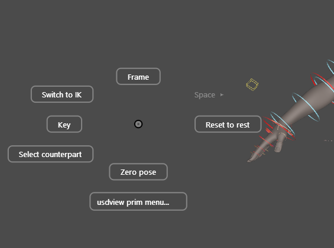
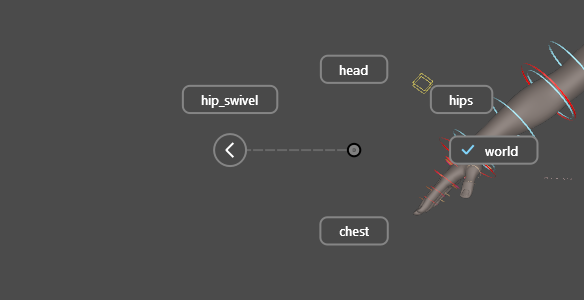

# Marking menu

Right-click in the viewport while controls are selected, or over a control,
and a radial menu replaces usdview's own right-click menu. A
[TouchPose](touchpose.md) region counts as its control: it is just a bigger
target.

<figure markdown>

<figcaption>The Selection menu. The row below the ring opens usdview's own
prim menu.</figcaption>
</figure>

## Three ways to use it

**Flick.** Press, flick toward a direction and release. The command runs
without the menu ever being drawn: once your hand knows the directions, this
is the fast path.

**Hold.** Keep the button down and the ring appears around the cursor.
Release over an item to run it.

**Tap.** A quick press and release leaves the ring up to be clicked. Escape,
or a click away from it, dismisses it.

A label, or a row of the column below the ring, wins whenever the cursor is on
it, whether you are holding or clicking.

## What it acts on

The menu acts on the selection. Right-clicking a control that is not selected
selects it first, so what the menu acts on is always what is highlighted.
With nothing selected and no control under the cursor, the right-click stays
usdview's, and ++alt++ + right-drag is still the camera's zoom.

## The Selection menu

| Direction | Item | Does |
|---|---|---|
| West | **Key** | Key every posed channel of the selection at the current frame. |
| East | **Reset to rest** | Put the transform channels back to rest, keyed in animation mode. |
| South | **Zero pose** | Clear every pose channel (IK/FK, spaces, rolls as well as transforms), as the picker's Zero Ctrls does. |
| North | **Frame** | Frame the selection. |
| North-West | **Switch to IK / FK** | Switch the selection's limbs, matched. See [limbs](limbs.md). |
| North-East | **Space ▸** | The control's named spaces, the current one checked. Switching keeps the control where it is. |
| South-West | **Select counterpart** | Select the mirrored control (`L_` and `R_`, `_l_` and `_r_`, and the like). |
| Below the ring | **usdview prim menu…** | usdview's own right-click menu for the control. |

Items that do not apply are hidden while you flick, and greyed out once the
ring is up to be read.

## Submenus

A submenu (**Space**, for example) opens around a new centre and leaves a
round **‹** circle where its parent was, with a dashed trail between them.
Move back onto the circle to return to that menu; with several levels open,
every parent leaves a circle, and returning to one closes every submenu below
it.

<figure markdown>
{ width="420" }
<figcaption>The Space submenu. The circle sits outside the ring, and the
direction pointing at it is left empty.</figcaption>
</figure>

A back circle never sits inside a submenu's ring or under one of its buttons:
a submenu opens far enough out to clear every parent, and leaves empty any
direction whose label would reach a circle.
