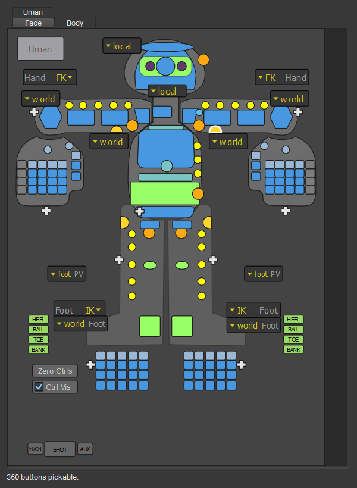
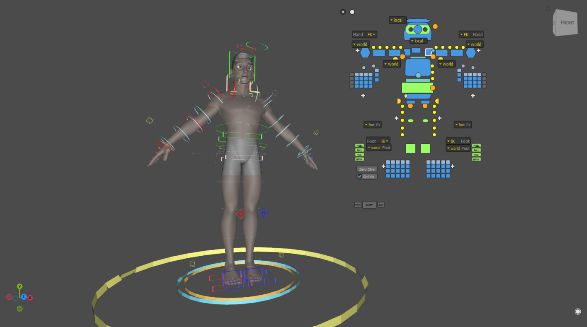

# Control picker

A picker is part of the rig: [`RigExecPicker`](../nodes/picker.md) prims
composed into the stage, with one [panel](../nodes/picker_panel.md) per tab
and one [button](../nodes/picker_button.md) per control. Because it is scene
data, a studio can override a single button in a layer it owns, and a stage
with three characters shows three pickers with nothing to configure.

The picker shows only buttons whose control exists in the rig, and each limb
shows only the half (IK or FK) that is driving it.

## The docked picker

Open it with **RigExec ▸ Animation Editors ▸ Control Picker**: one tab per
character, one inner tab per panel.

<figure markdown>
{ width="360" }
<figcaption>The biped's Body panel. Each limb shows the half (IK or FK) that is
driving it, and its switch button names the current state.</figcaption>
</figure>

### Selecting

| Gesture | Does |
|---|---|
| Click | Select the button's controls, replacing the selection. |
| ++shift++ + click | Add the controls, or remove them if already selected. |
| ++ctrl++ + click | Remove the controls. |
| ++alt++ + any of the above | Bring the mirrored control along. |
| Drag | Box-select every button the box touches, with the same modifiers. |
{ .rx-keys }

### Switches and commands

- **IK/FK buttons** switch the limb to its other half **matched**: the
  controls taking over are placed on the pose first, so nothing moves.
  See [limbs](limbs.md).
- **Space buttons** with more than two choices open a menu of the named
  spaces; picking one switches without moving the control.
- **Zero Ctrls** clears the pose of the selected controls, or the whole
  rig when nothing is selected.
- **Ctrl Vis** shows or hides the rig's controls.

### Keys

| Key | Does |
|---|---|
| ++ctrl+a++ | Select every control in the picker |
| ++ctrl+shift+a++ | Clear the selection |
| ++ctrl+i++ | Invert the selection |
| ++f++ | Frame the selection |
| ++1++ to ++9++ | Show that panel |
| ++q++ ++w++ ++e++ ++r++ | Change the viewport tool, as over the viewport |
{ .rx-keys }

## The hover picker

Press ++p++ (or **RigExec ▸ Animation Editors ▸ Hover Picker**) to draw the
picker's tabs straight into the viewport, in screen space. There is no window
around them: everywhere that is not a button still belongs to the viewport, so
selecting, box-selecting, gizmos and camera moves all work as usual.

<figure markdown>

<figcaption>Each tab hangs off a small round handle. Collapsed tabs wait as
handles in a row.</figcaption>
</figure>

### Gestures

| Where | Gesture | Does |
|---|---|---|
| Handle | Drag | Move the tab; its buttons follow. |
| Handle | ++shift++ + drag | Scale the tab about its handle (right or up grows). |
| Handle | Double-click | Collapse the tab to its handle, or expand it. |
| Handle | Hover | Show the tab's name. |
| Button | Click, ++shift++, ++ctrl++, ++alt++ | Select, exactly as in the docked picker. |
| Button | Drag | Box-select within the tab. |
| Button or handle | Middle-drag left or right | Fade the whole tab. |
| Knob (bottom right) | Drag left or right | Fade every tab at once; double-click for full. |
{ .rx-keys }

### Layout

Each tab remembers its position, scale, opacity and whether it is collapsed,
per user; nothing is written to the stage. A tab is anchored to the viewport
corner it was put down nearest, so it follows that corner as the window
resizes, and it is kept on screen when the viewport shrinks.

!!! tip "Gizmo group pivot"
    ++p++ belongs to the hover picker. The gizmo's group-pivot cycle is
    ++shift+p++.

## Authoring a picker

The picker's schema, and how its buttons bind to controls and switches, is in
the node reference: [Picker](../nodes/picker.md),
[Picker Panel](../nodes/picker_panel.md) and
[Picker Button](../nodes/picker_button.md).
