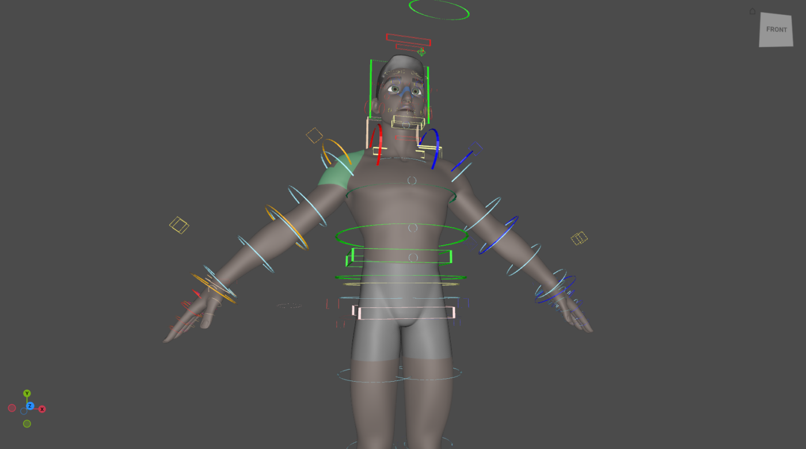

# TouchPose

Touch the character to select the control that moves it. Hover the skin and
the painted region under the cursor lights up; click, and that region's
control becomes the selection.

Open **RigExec ▸ Animation Editors ▸ TouchPose** and tick *Touch the
character to select its control* (or press ++t++ in the panel).

<figure markdown>

<figcaption>Regions light up on the deforming skin itself; nothing is added to
the stage.</figcaption>
</figure>

## Selecting

The rules are the Control Picker's, to the letter.

| Gesture | Does |
|---|---|
| Click a region | Select its control, replacing the selection. |
| ++shift++ + click | Add or remove. |
| ++ctrl++ + click | Remove. |
| Drag | Box-select every region the box touches, plus any control it covers. |
| Click the skin off every region | Clear the selection (with no modifier). |
| Click away from the character | Left to usdview: the camera, the gizmo and normal picking still work. |
| Right-click a region | The [marking menu](marking-menu.md), for that region's control. |
{ .rx-keys }

While TouchPose is on, the character's mesh is not selectable: a click on the
skin belongs to TouchPose. TouchPose stands down while a gizmo drag or a scrub
is in progress, and comes back when it ends.

## Painting regions

Regions are authored by painting. With **Paint** on (++p++ in the panel), a
drag gives the faces under the brush to the region selected in the panel's
list, and ++shift++ + drag takes them away. Painting edits the regions in
memory; **Save regions** (++ctrl+s++) writes the touch layer beside the rig,
never the rig itself.

| Key (in the panel) | Does |
|---|---|
| ++t++ | Turn TouchPose on or off |
| ++p++ | Turn painting on or off |
| ++ctrl+a++ | Select every region's control |
| ++ctrl+shift+a++ | Clear the selection |
| ++ctrl+i++ | Invert the selection |
| ++ctrl+s++ | Save the regions |
{ .rx-keys }

The panel also sets the highlight's **opacity** and the colours of the
**lead** (last selected) and **selected** regions.

## How it stays fast

The pick is a bounding-volume tree over the *posed* triangles, refit in
parallel when the rig publishes a new pose, so a ray costs microseconds. The
highlight is a shader on the skin's own material, fed a per-face region id and
a small colour table: hovering uploads one value, and nothing is authored on
the stage.

## Authoring regions as data

Regions are [`RigExecTouchRegions`](../nodes/touch_regions.md) and
[`RigExecTouchRegion`](../nodes/touch_region.md) prims, composed into the
stage beside the rig the way a picker is.
